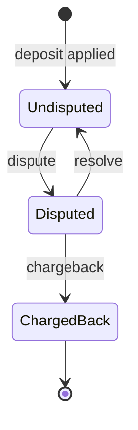

# Design

## Data flow

`main` checks the arguments and opens the file. `run` reads one record at a time, converts it into a typed `Transaction`, and hands it to the `Engine`. When the input ends, the accounts are written as CSV. The engine performs no I/O.

| Module | Responsibility |
|---|---|
| `src/main.rs` | Arguments, file, standard streams, exit status |
| `src/lib.rs` | `run(input, output)` and the fatal `Error` type |
| `src/csv_io.rs` | Reader settings, record validation, report writer |
| `src/engine.rs` | Accounts, recorded deposits, the rules for each transaction |
| `src/money.rs` | Fixed-point amounts: parsing, arithmetic, rendering |

## Types and invariants

- `Money` is a signed 64-bit count of ten-thousandths. `Amount` wraps it, is never negative, and can only be created by parsing.
- `Transaction` is an enum. Deposits and withdrawals carry an `Amount`; disputes, resolutions and chargebacks carry only ids.
- `ClientId` and `TxId` are distinct types.
- `Account` holds `available`, `held`, `total` and `locked`. Its fields are private and change only through five methods (deposit, withdraw, hold, release, charge back). Each returns new balances without modifying the account, so the caller commits them together with the history change or not at all.
- The engine owns accounts in a `BTreeMap` ordered by client id and a `HashMap` from transaction id to recorded deposit (owner, amount, dispute state).

Applying a transaction returns `Ok(Applied)`, `Ok(Ignored(reason))` or `Err(Overflow)`. The first two are normal and the run continues. The third stops the run.

Invariants. The engine tests check 1 and 2 after every step; 3 to 5 have dedicated tests:

1. `total = available + held`.
2. `held` is never negative and equals the sum of the client's currently disputed deposits.
3. An ignored operation changes no balance, no lock and no dispute state. It may create an all-zero account for a client seen for the first time.
4. An operation that overflows changes nothing.
5. Once an account is locked, its balances, its lock and the state of its deposits never change again.

## Dispute state and account lock

Dispute state belongs to a deposit:

Any event not shown is ignored. The lock belongs to the account, not to a deposit. A chargeback sets it, and from then on every operation for that client is ignored, so no deposit of a locked account changes state again.

## Worked example: spent deposit and two disputes

A client deposits 100 and 30, withdraws 110, then both deposits are disputed and the first is charged back (`tests/fixtures/chargeback_spent_deposit.csv`).

| Record | available | held | total | locked |
|---|---|---|---|---|
| deposit 100, deposit 30 | 130 | 0 | 130 | no |
| withdrawal 110 | 20 | 0 | 20 | no |
| dispute first deposit | −80 | 100 | 20 | no |
| dispute second deposit | −110 | 130 | 20 | no |
| chargeback first deposit | −110 | 30 | −80 | yes |
| deposit 50 | ignored | | | yes |
| resolve second deposit | ignored | | | yes |

The negative total is what the client owes after withdrawing money whose deposit was reversed. The second dispute stays open and its 30 stays held: the account is frozen, and the totals still add up.

## Decisions

| Choice | Alternative | Consequence |
|---|---|---|
| Integer ten-thousandths in `i64` | Floating point; a decimal library; `i128` | Exact, small and fully testable. Values are limited to about 9.2e14 |
| Stop the run on a record that cannot be interpreted, or on overflow | Skip the record and continue | No report is produced from input the program could not fully process; one bad record costs the whole run |
| A lock ignores every later operation for the client | Keep settling open disputes after a lock | One simple rule; funds held at the lock stay held |
| Zero amounts are accepted | Require a positive amount | No restriction beyond the stated format; a zero deposit is still a recorded, disputable transaction |
| Store `total` and update it with checked arithmetic | Derive it and validate the sum whenever balances change | Both are safe. Storing keeps each rule a direct transcription and lets tests check the identity |
| Only deposits are recorded and disputable | Record every transaction | Less memory; a dispute naming a withdrawal is treated as unknown |
| Disputes may drive balances negative | Refuse a dispute without enough funds | Matches a reversal initiated outside the account holder's control |
| Ignore a deposit that reuses a recorded deposit id | Overwrite; track every id | No extra memory; dispute history cannot be corrupted |
| Accounts in an ordered map | Hash map plus a sort | Stable, repeatable output |
| String records with `csv` and `serde`; ids and amounts parsed by our own digit checks | Byte records; the library's integer decoding | UTF-8 is checked by the reader; ids such as `+7` or `0x10` are rejected rather than reinterpreted |

## Complexity

With N records, C clients, D recorded deposits and L the longest record:

- Time is expected O(N log(C + 1) + C) for records of bounded size: one ordered-map lookup per record, expected constant-time hash lookups for deposits, and O(C) for the report. Since C is at most 65,536, this is effectively linear in N.
- Memory is O(C + D + L). Input is read one record at a time, so the file is never held in memory; each record costs memory proportional to its own length.
- An array indexed by transaction id would instead cost memory proportional to the largest id, which is unusable for sparse 32-bit ids.

## Serving many streams (not implemented)

The engine is a single-owner state machine and `run` accepts any reader. For many streams feeding one ledger, records could be routed by client id to single-threaded workers behind bounded queues, with deposit history in persistent storage. That serialises updates once events have an order. It does not by itself establish the order of events arriving from independent producers; that needs a sequencing rule at ingress.
